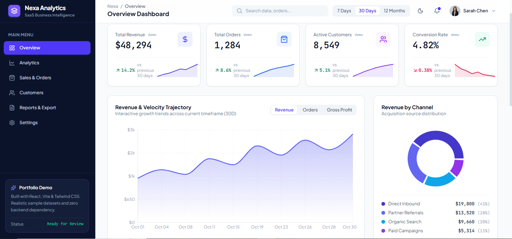
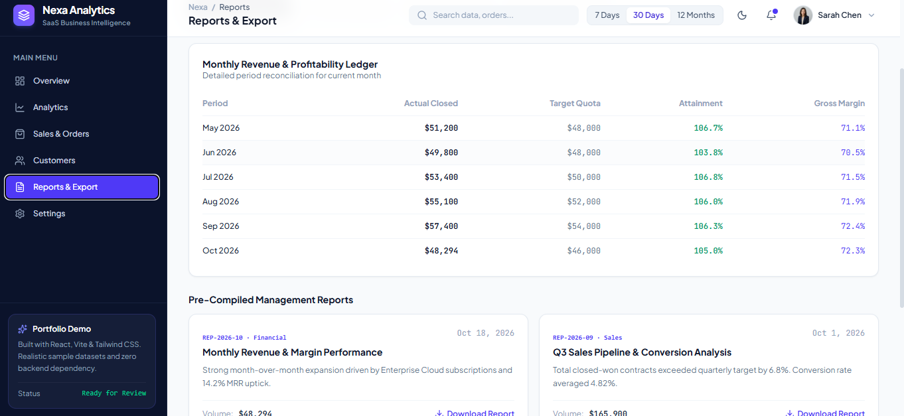

# Nexa Analytics — Modern Business Dashboard

A premium, responsive business analytics dashboard built to showcase modern SaaS UI design, business metrics, and interactive data visualizations.

🔗 **Live Demo:** [View Nexa Analytics](https://modern-business-dashboard.netlify.app/)


## 📊 Screenshots

### Home Page


### Reviews


### Analytics


## ✨ Features

- 📈 Business revenue and performance metrics
- 💰 Revenue, orders, and customer KPI cards
- 📊 Interactive charts and data visualizations
- 🛍️ Sales and business analytics
- 🔎 Search and filtering interface
- 📅 Date-range selection
- 🧭 Sidebar navigation
- 📱 Responsive design for desktop, tablet, and mobile
- 🎨 Premium SaaS dashboard interface
- 🧪 Sample data for demonstration purposes

## 🛠️ Technologies Used

- React
- Vite
- TypeScript
- CSS
- Charting library used in the project

## 🚀 Getting Started

### Prerequisites

- Node.js
- npm

### Installation

1. Clone the repository:

   ```bash
   git clone YOUR_GITHUB_REPOSITORY_URL
   ```

2. Open the project folder:

   ```bash
   cd YOUR_PROJECT_FOLDER
   ```

3. Install dependencies:

   ```bash
   npm install
   ```

4. Start the development server:

   ```bash
   npm run dev
   ```

5. Create a production build:

   ```bash
   npm run build
   ```

## 🎯 Project Purpose

Nexa Analytics is a frontend portfolio project demonstrating dashboard UI development, responsive layouts, data visualization, and modern React component design.

## 📌 Demo Disclaimer

This project is intended for portfolio and demonstration purposes. Dashboard metrics use sample data and should not be interpreted as real business performance.

## 👩‍💻 Developer

**Nasima Khatoon**

- GitHub: [Nasima-dev](https://github.com/Nasima-dev)

## 📄 License

This project is available for learning and portfolio demonstration. Add a license file if you intend to distribute the source under specific license terms.
